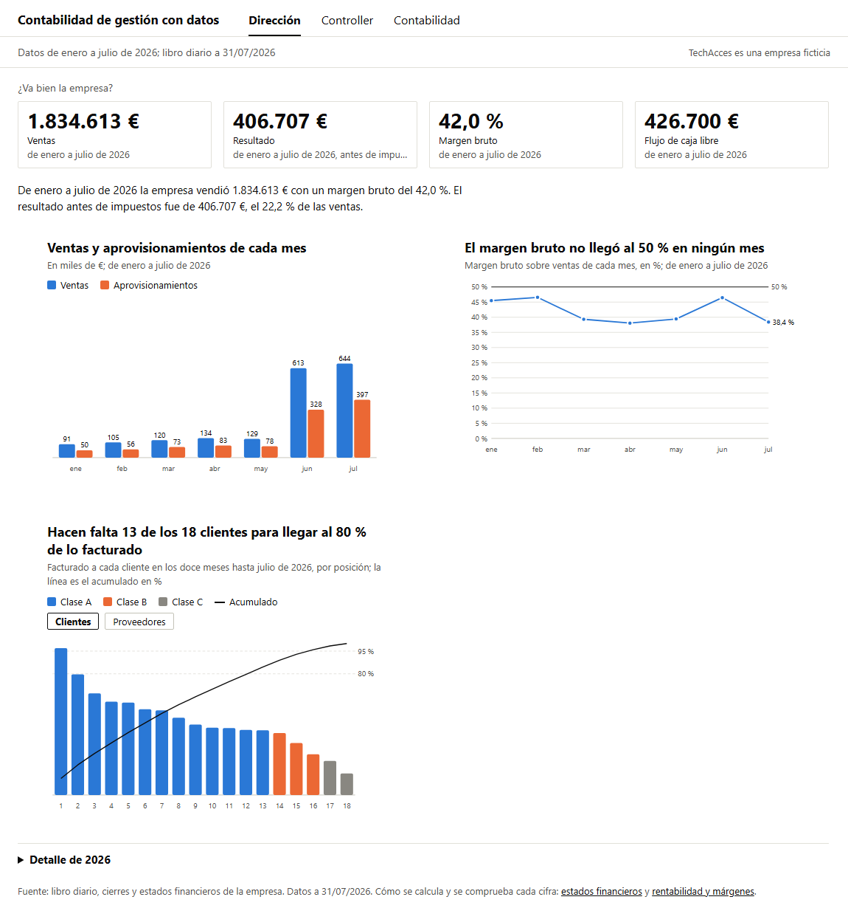
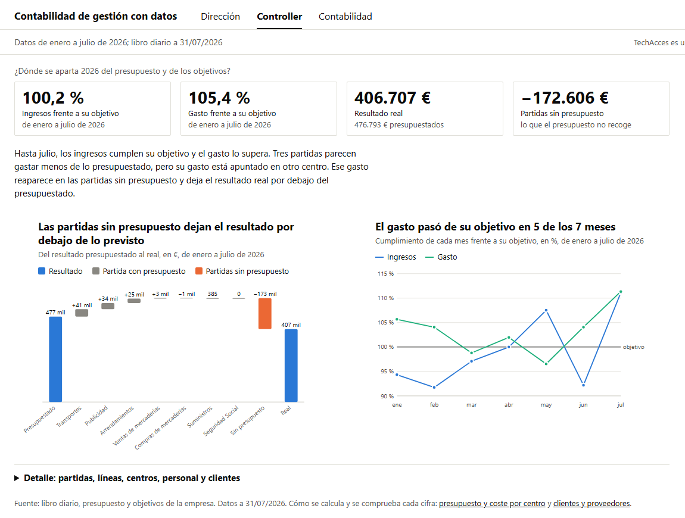
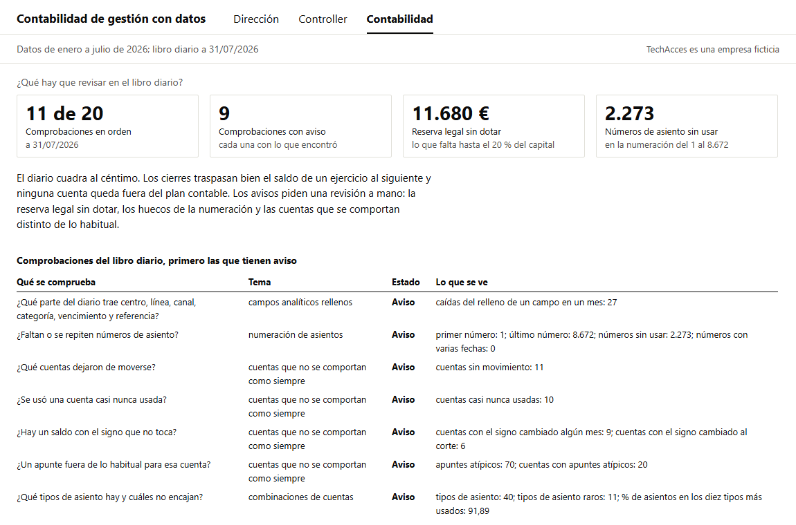

Versión en español: [README.md](README.md)

# Management accounting with data

Three dashboards built on a small business's general ledger: one for management, one for the controller and one for
accounting. Almost every figure is checked against an independent second calculation before it is published. The
company, TechAcces SL, is fictional: its books were generated for the project.

**Result:** from January to July 2026 the company sold €1,834,612.84 and earned €406,707.28, which is €70,085.60 less
than budgeted. Three budget lines that seemed to save €100,479.60 had their spending booked to another cost centre.

**Tools:** SQL (MySQL), Python, Power BI (DAX and Power Query), HTML and JavaScript.

[](https://github.com/jleonceo/management-accounting-analytics/actions/workflows/ci.yml)

```bash
git clone https://github.com/jleonceo/management-accounting-analytics.git
cd management-accounting-analytics
python -m http.server
```

Then open `http://localhost:8000` in a browser. The Power BI version is in [`powerbi/`](powerbi/).

The dashboards and the reports are written in Spanish.

## The three views

| View | Question it answers | What it shows |
|---|---|---|
| Management | How is the company doing? | sales, result, gross margin and free cash flow from January to July and their month-by-month trend; in Power BI, also the balance sheet at 31 July |
| Controller | Where does it deviate from the budget? | variance bridge by budget line, cost by cost centre and degree of target achievement |
| Accounting | Is the general ledger well kept? | twenty checks on the ledger, with what each one detects |

At 31/07/2026, nine of the twenty checks flag issues that need manual review, among them the unfunded legal reserve
and 2,273 unused journal entry numbers.







## How each figure is checked

The figures come from an analysis program that reads the general ledger in MySQL. Almost all of them have been
recalculated with a separately written SQL query, with the same result to the cent. The few without a second
calculation say so in their report. The [reports](informes/README.md) explain, analysis by analysis, the question, the
formula, the figure, how it was checked and when the figure can mislead.

On every change that is pushed, GitHub runs [`comprobar.py`](comprobar.py): the files the web page reads exist and have
rows, the figures on this page come from the files in `datos/`, and the links lead to files that exist.

An independent review, with its own SQL queries, found the three budget lines mentioned at the top. The budget bridge
showed spending below budget on them: that spending was booked to another cost centre. The detail is in
[Presupuesto y coste por centro](informes/03_presupuesto_objetivos_y_centros.md) (budget and cost by centre).

## Power BI

[`powerbi/contabilidad_gestion.pbip`](powerbi/contabilidad_gestion.pbip) is a Power BI project with the same three
views. Its 19 tables read the same files in `datos/` as the web page, so both show the same figures. It opens in Power
BI Desktop and updates with «Actualizar» (Refresh).

## What is in the repository

| File | What it is |
|---|---|
| `index.html`, `cuadro.js`, `estilo.css` | the web page with the three dashboards |
| [`datos/`](datos/) | the 19 CSV files read by the web page and Power BI, with `metadatos.json` (the period each one covers) |
| [`informes/`](informes/) | six reports by block, with the method and the check behind each figure |
| [`powerbi/`](powerbi/) | the Power BI project |
| [`comprobar.py`](comprobar.py), [`tests/`](tests/) | the checks GitHub runs on every change, and their tests |
| [`assets/`](assets/) | the images of the three views |

## Limits

- Only the 2026 financial year, January to July, is published. The years 2023 to 2025 come from generated data in
  which purchases do not follow sales: their margins are not those of a real small business. The second calculation
  still checks them, but they are not published.
- 2026 is an incomplete year: its figures cover seven months and are not compared with a full year.
- The second calculation ran on the project's MySQL database, which is not published. The repository includes the
  results already calculated. Since the full general ledger stays in that database, the check cannot be repeated from
  here.
- EBITDA is not published: two calculations in the project define it differently and give different figures.

## Related repositories

- [tesoreria-forecast-ia](https://github.com/jleonceo/tesoreria-forecast-ia): month-by-month cash forecasting, with
  its error measured on historical data.
- [control-interno-fraude-ia](https://github.com/jleonceo/control-interno-fraude-ia): accounting fraud detection in a
  ledger.
- [accounting-agent-swarm](https://github.com/jleonceo/accounting-agent-swarm): AI agents that post the journal
  entries of this same company.

---

*Part of [Juan Luis León](https://github.com/jleonceo)'s portfolio · [juanluisleon.vercel.app](https://juanluisleon.vercel.app) · Licence [MIT](LICENSE)*
