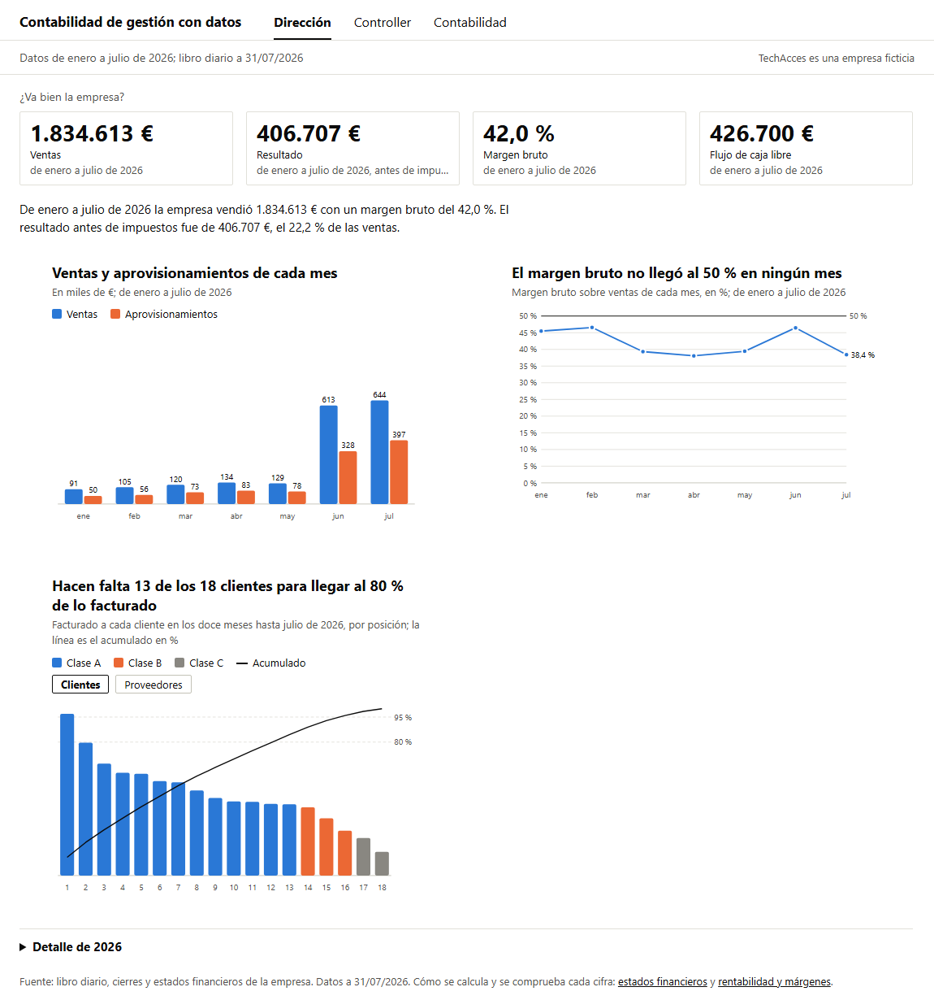
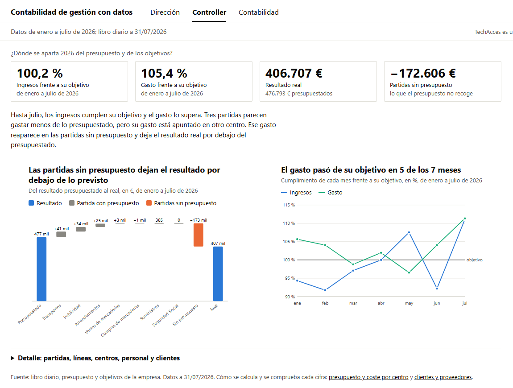
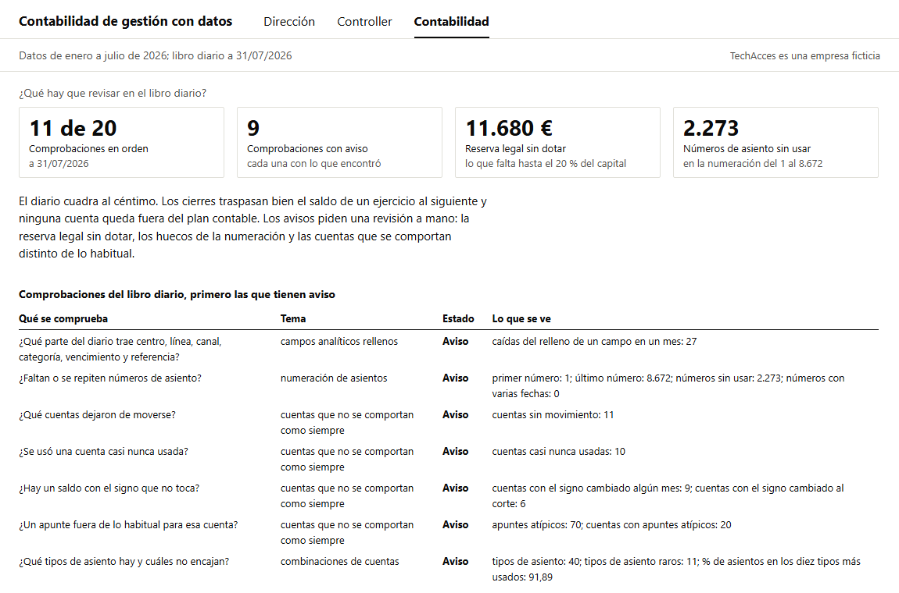

English version: [README.en.md](README.en.md)

# Contabilidad de gestión con datos

Tres cuadros de mando sobre el libro diario de una pyme: uno para dirección, otro para el controller y otro para
contabilidad. Casi todas las cifras se comprueban con un segundo cálculo independiente antes de publicarse. La empresa, TechAcces
SL, es ficticia: su contabilidad se generó para el proyecto.

**Resultado:** de enero a julio de 2026 la empresa vendió 1.834.612,84 € y ganó 406.707,28 € antes de impuestos, que
son 70.085,60 € menos de lo presupuestado. Casi toda la diferencia viene de 73.690,68 € de gastos que no tenían
presupuesto.

**Herramientas:** SQL (MySQL), Python, Power BI (DAX y Power Query), HTML y JavaScript.

[](https://github.com/jleonceo/management-accounting-analytics/actions/workflows/ci.yml)

```bash
git clone https://github.com/jleonceo/management-accounting-analytics.git
cd management-accounting-analytics
python -m http.server
```

Después se abre `http://localhost:8000` en el navegador. La versión de Power BI está en [`powerbi/`](powerbi/).

## Las tres vistas

| Vista | Pregunta que contesta | Qué muestra |
|---|---|---|
| Dirección | ¿Cómo va la empresa? | ventas, resultado, margen bruto y flujo de caja libre de enero a julio y su evolución mensual; en Power BI, además, el balance a 31 de julio |
| Controller | ¿Dónde se desvía del presupuesto? | puente de desviaciones por partida, coste por centro y grado de cumplimiento de objetivos |
| Contabilidad | ¿Está bien llevado el libro diario? | veinte controles sobre el diario, con lo que detecta cada uno |

A 31/07/2026, nueve de los veinte controles señalan incidencias que requieren revisión manual, entre ellas la
reserva legal sin dotar y 2.273 números de asiento sin usar.







## Cómo se comprueba cada cifra

Las cifras salen de un programa de análisis que lee el libro diario en MySQL. Casi todas se han vuelto a calcular con
una consulta SQL escrita aparte, con el mismo resultado al céntimo. Las pocas que no tienen un segundo cálculo lo
indican en su informe. Los [informes](informes/README.md) explican, análisis por análisis, la pregunta, la fórmula, la
cifra, su comprobación y en qué casos la cifra puede llevar a error.

En cada cambio que se sube, GitHub ejecuta [`comprobar.py`](comprobar.py): los ficheros que lee la web existen y tienen
filas, las cifras de esta portada salen de los ficheros de `datos/` y los enlaces llevan a ficheros que existen.

Una revisión externa, con consultas SQL propias, señaló 16 defectos en los datos y en el cálculo. El informe
[Lo que los datos no sostienen](informes/07_lo_que_los_datos_no_sostienen.md) los mide uno a uno con el mismo diario:
cuánto mueve cada uno las cifras publicadas y qué haría falta para corregirlo. Catorce se confirman y dos se corrigen
en parte.

## Power BI

[`powerbi/contabilidad_gestion.pbip`](powerbi/contabilidad_gestion.pbip) es un proyecto de Power BI con las mismas
tres vistas. Sus 19 tablas leen los mismos ficheros de `datos/` que la web, así que las dos muestran las mismas cifras.
Se abre con Power BI Desktop y se actualiza con «Actualizar».

## Qué hay en el repositorio

| Fichero | Qué es |
|---|---|
| `index.html`, `cuadro.js`, `estilo.css` | la web de los tres cuadros de mando |
| [`datos/`](datos/) | los 19 ficheros CSV que leen la web y Power BI, con `metadatos.json` (periodo que cubre cada uno) |
| [`informes/`](informes/) | seis informes por bloque, con el método y la comprobación de cada cifra, y uno con lo que los datos no sostienen |
| [`powerbi/`](powerbi/) | el proyecto de Power BI |
| [`comprobar.py`](comprobar.py), [`test_comprobar.py`](test_comprobar.py) | las comprobaciones que ejecuta GitHub en cada cambio y sus pruebas |
| [`assets/`](assets/) | las imágenes de las tres vistas |

## Límites

- Se publica solo el ejercicio 2026, de enero a julio. Los años de 2023 a 2025 salen de datos generados en los que las
  compras no siguen a las ventas: sus márgenes no son los de una pyme real. El segundo cálculo los sigue comprobando,
  pero no se publican.
- 2026 es un ejercicio incompleto: sus cifras son de siete meses y no se comparan con un año entero.
- El segundo cálculo se hizo sobre la base de datos MySQL del proyecto, que no se publica. El repositorio incluye los
  resultados ya calculados. Como el libro diario completo se queda en esa base, la comprobación no se puede repetir
  desde aquí.
- El EBITDA no se publica: dos cálculos del proyecto lo definen de forma diferente y dan cifras distintas.
- Junio y julio aportan el 79,20 % del resultado de los siete meses, con un volumen de ventas que el diario no
  explica. El resultado es antes de impuestos, porque el diario no registra el Impuesto sobre Sociedades. Las
  existencias solo se recuentan a fin de año. El detalle está en
  [Lo que los datos no sostienen](informes/07_lo_que_los_datos_no_sostienen.md).

## Repositorios relacionados

- [tesoreria-forecast-ia](https://github.com/jleonceo/tesoreria-forecast-ia): previsión de caja mes a mes, con su
  error medido sobre datos históricos.
- [control-interno-fraude-ia](https://github.com/jleonceo/control-interno-fraude-ia): detección de fraude contable
  en un libro de asientos.
- [accounting-agent-swarm](https://github.com/jleonceo/accounting-agent-swarm): agentes de IA que contabilizan los
  asientos de esta misma empresa.

---

*Parte del portfolio de [Juan Luis León](https://github.com/jleonceo) · [juanluisleon.vercel.app](https://juanluisleon.vercel.app) · Licencia [MIT](LICENSE)*
